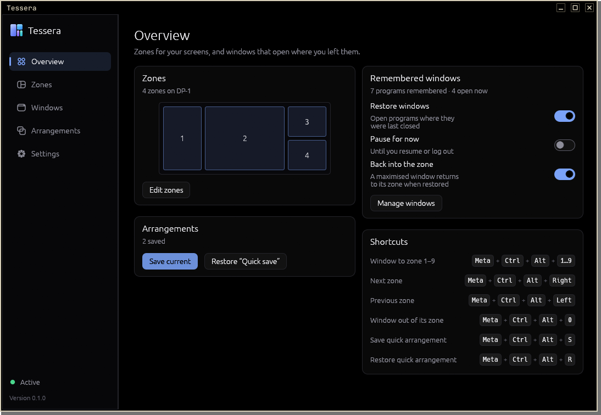
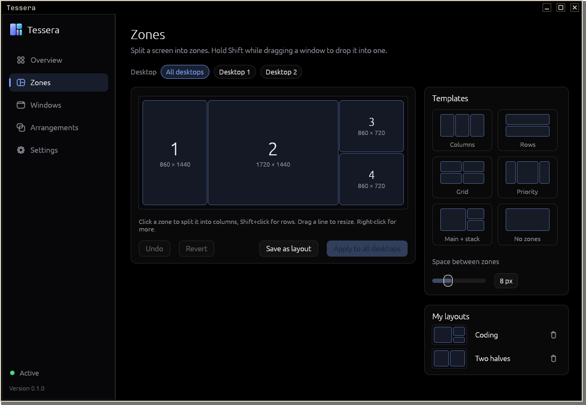
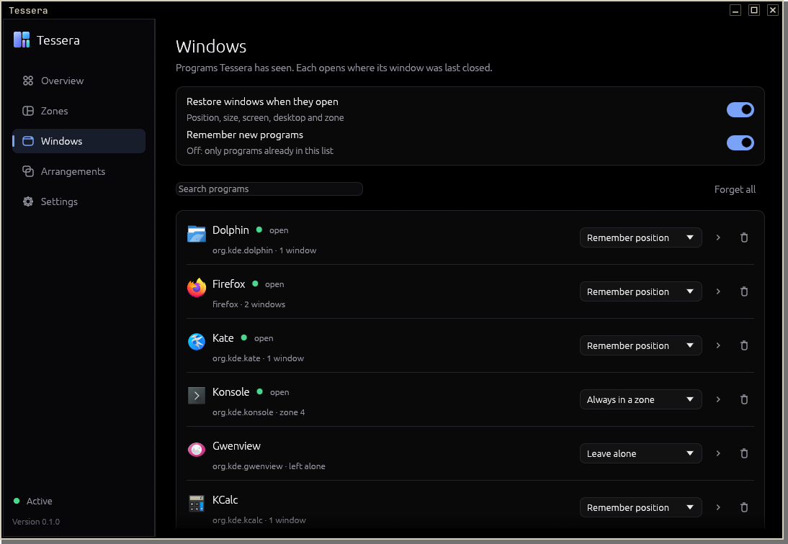
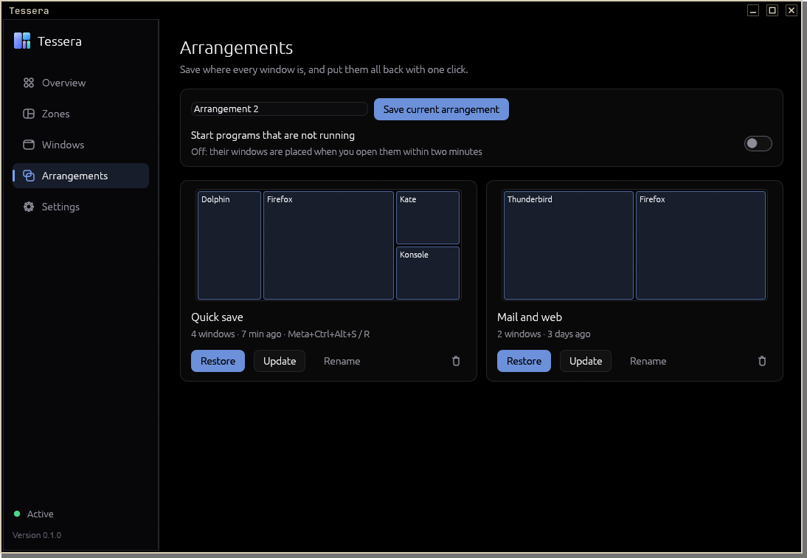

# Tessera

Window zones and remembered window positions for KDE Plasma 6.

Draw zones for each screen, drop windows into them, and let every program
open where its window was last closed.

<br clear="left">



## Features

- Zone editor: templates, click to split, drag dividers, spacing, saved layouts,
  undo. One layout per screen, for all or single virtual desktops
- Zones are KWin's own tiles, so Shift+drag into a zone works as usual
- Programs reopen with their position, size, screen, virtual desktop, zone and
  maximised or full-screen state
- Several windows per program, matched by title where possible
- Per program: remember, always open in a fixed zone, or leave alone
- Arrangements: save where every window is and restore it later; programs that
  are not running can be started or placed when they open
- A maximised window goes back into its zone when restored
- Shortcuts for moving windows between zones
- Pause restoring from the tray, a shortcut or the command line
- Warns about other KWin scripts that move windows too and can turn them off
- Tray icon, start at login, updates from the settings
- True-black theme, seven accents







## Requirements

KDE Plasma 6 (KWin) on Wayland or X11. Other desktops are not supported: on
Wayland only the compositor can move windows, and Tessera does that through a
KWin script.

## Install

Download `tessera-linux-x86_64.tar.gz` from the
[latest release](https://github.com/Benett53/Tessera/releases/latest), then:

```bash
tar xzf tessera-linux-x86_64.tar.gz
./Tessera/install.sh
```

Installs to `~/.local/bin` with a menu entry and icons, starts the background
service and turns on start at login. `sudo ./install.sh --system` installs to
`/usr/local` instead. Running a newer `install.sh` updates in place and keeps
settings and saved windows.

`~/.local/lib/tessera/uninstall.sh` removes the program, the KWin script, the
menu entry and the autostart entry. `--purge` also removes settings, remembered
windows and arrangements.

## Using it

| Action | How |
|---|---|
| Open | Application menu, tray icon, or `Meta+Ctrl+Alt+T` |
| Change zones | Zones → pick a template or click a zone to split it → Apply |
| Split into rows instead of columns | Shift+click |
| Remove a zone | Right-click it |
| Put a window into a zone | Hold Shift while dragging it, or the shortcuts below |
| Pin a program to a zone | Windows → "Always in a zone" → click the zone |
| Save all window positions | Arrangements → Save, or `Meta+Ctrl+Alt+S` |
| Restore them | Arrangements → Restore, or `Meta+Ctrl+Alt+R` |
| Pause restoring | Tray menu, or Overview → "Pause for now" |

### Shortcuts

| Keys | Action |
|---|---|
| `Meta+Ctrl+Alt+1` … `9` | Move the active window to zone 1–9 |
| `Meta+Ctrl+Alt+Right` / `Left` | Next or previous zone |
| `Meta+Ctrl+Alt+0` | Take the window out of its zone |
| `Meta+Ctrl+Alt+S` | Save the quick arrangement |
| `Meta+Ctrl+Alt+R` | Restore the quick arrangement |
| `Meta+Ctrl+Alt+T` | Open Tessera |

They are KWin shortcuts and can be changed in System Settings → Shortcuts →
KWin (search for "Tessera").

### Command line

```bash
tessera --save [NAME]       # save an arrangement (default: the quick one)
tessera --restore [NAME]    # restore an arrangement
tessera --pause / --resume  # pause or resume restoring
tessera --status
tessera --quit              # stop the service
```

## Configuration

| File | Content |
|---|---|
| `~/.config/tessera/config.json` | Settings and saved layouts |
| `~/.local/share/tessera/windows.json` | Remembered programs and their windows |
| `~/.local/share/tessera/snapshots.json` | Arrangements |

Written atomically. An unreadable file is moved to `*.json.broken`.
`TESSERA_HOME=<folder>` keeps everything in one folder instead.

Programs in the ignore list (Settings) are never moved or saved. `*` matches
anything, for example `steam_app_*` for games. Shells, launchers and dialogs are
left alone by default.

## How it works

| Part | Responsibility |
|---|---|
| `kwin/main.qml` | KWin script: reports windows, places them, builds tiles, registers shortcuts |
| `src/daemon.rs` | Background service on the session bus (`app.tessera.Daemon`), tray icon |
| `src/engine.rs` | Which remembered slot a window gets, what to restore, arrangements |
| `src/layout.rs` | Zone layouts as a split tree, the same shape as KWin's tiles |
| `src/kwin.rs` | Installs and loads the KWin script, finds conflicting scripts |
| `src/ui/` | The window: overview, zone editor, windows, arrangements, settings |

The service owns all data and installs the KWin script into
`~/.local/share/kwin/scripts/tessera`. The script calls the service for every
window that opens, moves or closes, and fetches commands with a long-poll. The
window is a separate process that only talks to the service, so closing it
changes nothing.

A program can have up to six windows remembered. A window that opens takes the
first free slot of its program, preferring one whose title matches.

## Network

The only network access is the update check, which asks GitHub for the latest
release: when "Check for updates" is pressed, and at most once a day while the
automatic check is on. An update is installed only if `SHA256SUMS` carries a
valid minisign signature from the key built into Tessera and the downloaded file
matches its checksum.

## Building

```bash
cargo build --release
cargo test
TESSERA_DEMO=tools/demo-state.json cargo run   # the window with sample data, no service
```

Debian/Ubuntu need `libxkbcommon-dev libwayland-dev libgl1-mesa-dev` and the X11
headers listed in `.github/workflows/ci.yml`.

## License

MIT, see [LICENSE](LICENSE).

Parts of this project were created with AI assistance.
